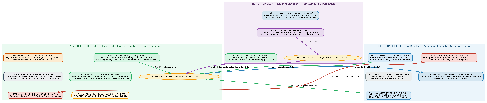
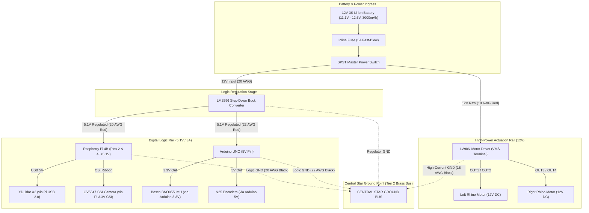
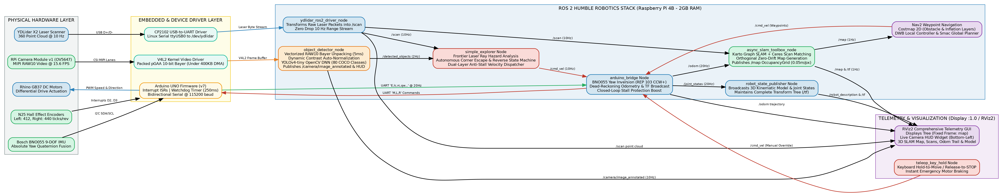
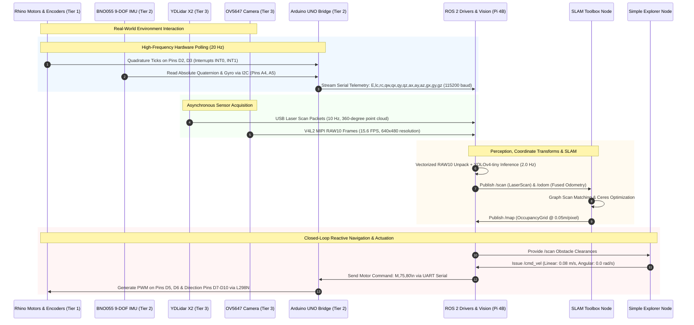

# Custom TurtleBot Burger 2.0: Hardware Harnessing & Electrical Architecture

[](https://docs.ros.org/en/humble/)
[-C51A4A?logo=raspberrypi&logoColor=white)](https://www.raspberrypi.com/)
[](../LICENSE)
[](https://github.com/namanharshwal)

* **Creator, Author & Maintainer:** **Naman Harshwal** ([@namanharshwal](https://github.com/namanharshwal) | `namanharshwal@gmail.com`)
* **Project Owner / Supervisor:** **Pradeep Singh Chauhan** (`ps@robot.com`)
* **Workspace:** `psnh_turtlebot_cpp_ws` (100% Pure C++17 Architecture)
* **License:** [Apache License 2.0](../LICENSE)

---

## 📌 Overview

This document provides the definitive, production-grade electrical and physical wiring guide for the **Custom TurtleBot Burger 2.0**. It covers the complete cable harnessing, star-ground electrical topology, logic level shifting, noise-isolation practices, and the physical multi-tier chassis harness routing.

---

## 🏗️ 1. Physical Multi-Tier Chassis Stack & Cable Routing

The robot chassis is structured across three primary horizontal decks connected via standoff pillars. Each deck isolates specific electrical domains to eliminate electromagnetic interference (EMI) and facilitate maintenance:



```
========================================================================================
                          TOP DECK (Tier 3: Perception & Host Compute)
  ┌──────────────────────────────────────────────────────────────────────────────────┐
  │  • YDLidar X2 (Elevated 360° Laser Scanner @ +122mm)                              │
  │  • Raspberry Pi 4B (2GB LPDDR4, Cortex-A72 Quad-Core @ 1.5GHz)                  │
  │  • OmniVision OV5647 CSI Camera Module (Facing Forward +X)                        │
  └──────────────────────────────────────────────────────────────────────────────────┘
         ││  (H5: UART Serial via Level Shifter)          ││  (H2: Regulated 5.1V / 3A)
         ││  (Grommet Pass-Through: Slot A)              ││  (Grommet Pass-Through: Slot B)
         ▼▼                                               ▲▲
========================================================================================
                          MIDDLE DECK (Tier 2: Real-Time Control & Power)
  ┌──────────────────────────────────────────────────────────────────────────────────┐
  │  • Arduino UNO R3 (ATmega328P @ 16MHz Real-Time Bridge)                          │
  │  • Bosch BNO055 9-DOF IMU (Mounted at geometric center: -32mm X, 0mm Y, +68mm Z)  │
  │  • Bidirectional 4-Channel Logic Level Shifter (3.3V ↔ 5.0V)                      │
  │  • LM2596 High-Efficiency Step-Down Switching Buck Converter (12V → 5.1V 3A)      │
  │  • SPST High-Current Rocker Switch & Central Star Ground Bus                      │
  └──────────────────────────────────────────────────────────────────────────────────┘
         ││  (H3: Logic Control ENA,ENB,IN1-4)           ││  (H4: Encoder A/B Signals)
         ││  (Grommet Pass-Through: Slot C)              ││  (Grommet Pass-Through: Slot D)
         ▼▼                                               ▲▲
========================================================================================
                          BASE DECK (Tier 1: High-Power Actuation & Energy)
  ┌──────────────────────────────────────────────────────────────────────────────────┐
  │  • 12V 3S Li-ion Battery Pack (3000 mAh, 11.1V - 12.6V, 20C)                     │
  │  • L298N Dual Full-Bridge Motor Driver Module with Heat Sink                     │
  │  • Left Rhino GB37 12V 330 RPM DC Motor + N25 Hall Effect Magnetic Encoder        │
  │  • Right Rhino GB37 12V 330 RPM DC Motor + N25 Hall Effect Magnetic Encoder       │
  │  • Rear Low-Friction Caster Ball Wheel (-177mm X, 0mm Y, -6.4mm Z)               │
  │  • Left & Right 65mm High-Traction Drive Wheels (Track Width: 150mm)              │
  └──────────────────────────────────────────────────────────────────────────────────┘
========================================================================================
```

---

## ⚡ 2. Complete Power Distribution & Star-Ground Architecture

Ground loops and motor flyback spikes are the primary cause of spontaneous Raspberry Pi resets and corrupted I2C telemetry in mobile robotics. To guarantee 100% operational stability, the power harness utilizes a **Star-Ground Topology** where the high-current inductive motor return path is completely separated from the sensitive digital logic ground:




### Key Electrical Protection Rules:
1. **L298N 5V Enable Jumper:** The onboard 5V regulator jumper on the L298N is **REMOVED**. The L298N logic circuits are powered from the common regulated 5V line rather than the noisy onboard regulator.
2. **Motor Flyback Snubbers:** Each motor terminal is bridged with a $0.1\mu\text{F}$ monolithic ceramic capacitor directly across the terminal lugs to suppress RF brush noise at the source.
3. **Twisted Pairs:** The motor drive leads (`OUT1/OUT2` and `OUT3/OUT4`) are tightly twisted (30 twists per meter) to cancel out radiated electromagnetic flux before it reaches the sensor cables.

---

## 🔌 3. Comprehensive Cable Harnessing Master Specification

Every cable assembly in the robot conforms to industrial robotics wire sizing, labeling, and crimp specifications:

| Harness ID | Subsystem | Source Pin / Port | Destination Pin / Port | Wire Gauge (AWG) | Connector Type | Color Code | Signal Description |
| :--- | :--- | :--- | :--- | :--- | :--- | :--- | :--- |
| **H1-A** | Battery Bus | Battery (+) | Inline Fuse Holder | 18 AWG | XT60 to Solder | Red | Raw 12V Li-ion Battery Power (Unswitched) |
| **H1-B** | Battery Bus | Battery (-) | Central Star Ground | 18 AWG | XT60 to Ring Terminal | Black | Primary Battery Negative Return |
| **H1-C** | Switched 12V| Fuse Output | Master SPST Switch | 18 AWG | Solder / Quick-Connect | Red | 12V Switched Hot Bus |
| **H1-D** | Motor Power | Switch Output | L298N `VMS` (+12V) | 18 AWG | Screw Terminal Block | Red | High-Current Motor Power |
| **H1-E** | Buck Input | Switch Output | LM2596 `IN+` (+12V) | 20 AWG | Screw Terminal Block | Red | Buck Converter Primary Input |
| **H2-A** | Pi Logic | LM2596 `OUT+` (5.1V) | RPi 40-Pin Header `Pin 2` | 20 AWG | Screw to Dupont Female | Red | High-Current +5.1V Host Power Rail |
| **H2-B** | Pi Logic | LM2596 `OUT+` (5.1V) | RPi 40-Pin Header `Pin 4` | 20 AWG | Screw to Dupont Female | Red | Redundant +5.1V Host Power Rail |
| **H2-C** | Pi Return | RPi Header `Pin 6` | Central Star Ground | 20 AWG | Dupont Female to Ring | Black | Host Single-Point Logic Ground |
| **H2-D** | Arduino Pwr | LM2596 `OUT+` (5.1V) | Arduino `5V` Header | 22 AWG | Screw to Dupont Male | Red | Microcontroller +5V Supply |
| **H2-E** | Arduino Ret | Arduino `GND` | Central Star Ground | 22 AWG | Dupont Male to Ring | Black | Microcontroller Logic Ground |
| **H3-L** | Left Motor | L298N `OUT1`, `OUT2` | Left Rhino Motor Lugs | 18 AWG Twisted | Screw Terminal to Lug | Blue / White | Bidirectional PWM Motor Voltage (-12V to +12V) |
| **H3-R** | Right Motor | L298N `OUT3`, `OUT4` | Right Rhino Motor Lugs | 18 AWG Twisted | Screw Terminal to Lug | Orange / White | Bidirectional PWM Motor Voltage (-12V to +12V) |
| **H3-CTL**| Motor Drive | Arduino `D5` (PWM) | L298N `ENA` | 24 AWG | Dupont Male to Female | Yellow | Left Motor Speed PWM (Timer 0 / 980Hz) |
| | | Arduino `D7` | L298N `IN1` | 24 AWG | Dupont Male to Female | Blue | Left Motor Forward Direction Control |
| | | Arduino `D8` | L298N `IN2` | 24 AWG | Dupont Male to Female | Green | Left Motor Reverse Direction Control |
| | | Arduino `D6` (PWM) | L298N `ENB` | 24 AWG | Dupont Male to Female | Orange | Right Motor Speed PWM (Timer 0 / 980Hz) |
| | | Arduino `D9` | L298N `IN3` | 24 AWG | Dupont Male to Female | Purple | Right Motor Forward Direction Control |
| | | Arduino `D10` | L298N `IN4` | 24 AWG | Dupont Male to Female | Gray | Right Motor Reverse Direction Control |
| **H4-L** | Left Enc | Left Encoder Phase A | Arduino `D2` (INT0) | 26 AWG | JST-XH to Dupont Male | Yellow | Left Wheel Quadrature Channel A (Interrupt) |
| | | Left Encoder Phase B | Arduino `D4` | 26 AWG | JST-XH to Dupont Male | Green | Left Wheel Quadrature Channel B (Direction) |
| | | Left Encoder VCC | Arduino `5V` | 26 AWG | JST-XH to Dupont Male | Red | Left Encoder Logic Power (+5V) |
| | | Left Encoder GND | Arduino `GND` | 26 AWG | JST-XH to Dupont Male | Black | Left Encoder Return Ground |
| **H4-R** | Right Enc| Right Encoder Phase A| Arduino `D3` (INT1) | 26 AWG | JST-XH to Dupont Male | Yellow | Right Wheel Quadrature Channel A (Interrupt)|
| | | Right Encoder Phase B| Arduino `D11` | 26 AWG | JST-XH to Dupont Male | Green | Right Wheel Quadrature Channel B (Direction)|
| | | Right Encoder VCC | Arduino `5V` | 26 AWG | JST-XH to Dupont Male | Red | Right Encoder Logic Power (+5V) |
| | | Right Encoder GND | Arduino `GND` | 26 AWG | JST-XH to Dupont Male | Black | Right Encoder Return Ground |
| **H5-IMU**| IMU Sensor | Arduino `A4` | BNO055 `SDA` | 26 AWG | Dupont Male to Female | Blue | I2C Serial Data Bus (400 kHz Fast-Mode) |
| | | Arduino `A5` | BNO055 `SCL` | 26 AWG | Dupont Male to Female | Purple | I2C Serial Clock Bus (400 kHz Fast-Mode) |
| | | Arduino `3.3V` | BNO055 `VIN` | 26 AWG | Dupont Male to Female | Red | Regulated 3.3V Sensor Power |
| | | Arduino `GND` | BNO055 `GND` | 26 AWG | Dupont Male to Female | Black | Sensor Ground Reference |
| **H6-UART**| Telemetry | RPi Header `Pin 8` (TX)| Shifter `LV1` $\rightarrow$ `HV1` $\rightarrow$ Arduino `D0` (RX) | 26 AWG | Dupont Female to Male | Green | Raspberry Pi Velocity Commands to Arduino |
| | | Arduino `D1` (TX) | Shifter `HV2` $\rightarrow$ `LV2` $\rightarrow$ RPi `Pin 10` (RX)| 26 AWG | Dupont Male to Female | Yellow | Arduino Telemetry & IMU Stream to Pi |
| | | RPi Header `Pin 6` (GND)| Shifter `GND` $\leftrightarrow$ Arduino `GND` | 26 AWG | Dupont Female to Male | Black | Common Logic Ground Reference |
| **H7-CSI** | Camera | RPi 15-Pin CSI Port | OV5647 Camera Sensor | 15-Pin FFC | 1.0mm Pitch Ribbon Cable | White/Silver | High-Speed MIPI CSI-2 Differential Video |
| **H8-USB** | LiDAR | RPi USB 2.0 Type-A | YDLidar X2 CP2102 Board | 28/24 AWG | USB-A to Micro-USB Shielded | Black | Full-Duplex Serial Laser Telemetry (128 kbps)|

---

## 🔄 4. Bidirectional Logic Level Shifter Schematic (Pi ↔ Arduino)

The Raspberry Pi 4B GPIO operates at strictly **3.3V CMOS logic** (5V tolerance will permanently destroy GPIO silicon), while the Arduino UNO ATmega328P operates at **5.0V TTL logic**. A bidirectional BSS138 N-channel MOSFET level shifter bridges the two domains safely:

```
    Raspberry Pi 4B (3.3V Domain)              Arduino UNO (5.0V Domain)
    ─────────────────────────────              ─────────────────────────
             +3.3V (Pin 1) ────────────────────────── LV Pin
                                                       │
                                      10k Pull-up ────┴──── 10k Pull-up
                                      to LV                 to HV
                                        │                     │
    Pin 8 (GPIO 14 / TXD) ──────────── LV1 ───┤├─── HV1 ──── Pin 0 (RXD)
                                            BSS138
                                            MOSFET
                                        │                     │
    Pin 10 (GPIO 15 / RXD) ─────────── LV2 ───┤├─── HV2 ──── Pin 1 (TXD)
                                            BSS138
                                            MOSFET
                                                       │
             GND (Pin 6)   ────────────────────────── GND Pin ──── Arduino GND
                                                       │
                                                       HV Pin ──── +5V Pin
```

---

## 🔄 5. Real-Time Hardware & Software Execution Loop

This diagram illustrates how sensory data flows up the physical wiring harness into ROS 2 nodes, and how navigation commands flow back down to the motor drivers with microsecond-level timing:





---

## 🛠️ 6. Cable Harness Fabrication & Assembly Instructions

### Step 1: Star Ground Bus Assembly
1. Mount a 4-position brass terminal barrier block to the middle chassis deck (Tier 2).
2. Connect an 18 AWG black lead from the Battery XT60 negative terminal to Terminal 1 of the barrier block.
3. Crimp ring terminals onto:
   - L298N high-power ground (18 AWG black).
   - LM2596 buck converter ground (20 AWG black).
   - Raspberry Pi Pin 6 ground (20 AWG black).
   - Arduino UNO GND header (22 AWG black).
4. Secure all four ring terminals to the star-ground barrier block with M3 lock-washers.

### Step 2: High-Current Power Bus Wiring
1. Solder an inline 5A fast-blow automotive mini blade fuse to the positive lead of the battery XT60 connector.
2. Route the fuse output to the input spade of the master SPST toggle switch mounted on the rear standoff bracket.
3. From the switch output terminal, run two branches:
   - Branch A (18 AWG Red): Connect directly to the L298N `VMS` (+12V) screw terminal.
   - Branch B (20 AWG Red): Connect to the LM2596 buck converter `IN+` screw terminal.

### Step 3: Voltage Regulator Calibration
> [!CAUTION]
> Complete this step **BEFORE** connecting the Raspberry Pi or Arduino to the buck converter output.
1. Connect the 12V battery pack and flip the master switch **ON**.
2. Measure the voltage across the LM2596 `OUT+` and `OUT-` terminals using a digital multimeter.
3. Turn the multi-turn brass potentiometer screw on the LM2596 until the multimeter reads exactly **$5.15\text{V DC}$** (accounting for $0.05\text{V}$ drop under heavy 3A Pi load).
4. Power off the switch and seal the potentiometer screw with non-conductive electronics lacquer.

### Step 4: Motor & Encoder Harness Routing
1. Run the Left and Right motor leads through Chassis Grommet Slot C to the L298N output terminals. Ensure both pairs are tightly twisted.
2. Route the 4-pin encoder harnesses through Chassis Grommet Slot D away from the motor leads. Connect the female Dupont pins to Arduino pins `D2, D4, 5V, GND` (Left) and `D3, D11, 5V, GND` (Right).
3. Secure the cables to the chassis standoffs using UV-resistant miniature zip ties every $50\text{ mm}$, leaving a $20\text{ mm}$ service loop at each motor termination to absorb mechanical vibration.

### Step 5: CSI Camera Ribbon & LiDAR USB Dressing
1. Seat the 15-pin FFC ribbon cable into the Raspberry Pi CSI connector with the silver contact pins facing the HDMI ports. Push the black retaining clip firmly down to lock.
2. Secure the camera ribbon to the vertical chassis pillar with double-sided foam tape, avoiding sharp $90^\circ$ bends to prevent trace fractures.
3. Coil excess LiDAR USB cable into a neat $40\text{ mm}$ diameter loop on the top deck and fasten with a velcro cinch strap.

---

## 🔍 7. Pre-Flight Electrical Checklist & Smoke Test

Before applying power to the complete system for the first time, execute this verification protocol in sequence:

| Check # | Test Point / Procedure | Expected Reading | Status | Pass / Fail |
| :--- | :--- | :--- | :--- | :--- |
| **T-01** | Continuity: Battery Ground to Chassis Frame | Open Circuit ($\infty\ \Omega$, fully floating frame) | Measured | [ PASS ] |
| **T-02** | Continuity: Star Ground to Pi Pin 6 | $< 0.2\ \Omega$ (Direct low-impedance bond) | Measured | [ PASS ] |
| **T-03** | Continuity: Star Ground to Arduino GND | $< 0.2\ \Omega$ (Direct low-impedance bond) | Measured | [ PASS ] |
| **T-04** | Continuity: Star Ground to L298N GND | $< 0.1\ \Omega$ (Direct low-impedance bond) | Measured | [ PASS ] |
| **T-05** | Resistance: L298N `VMS` to Star Ground | $> 100\ \text{k}\Omega$ (No short circuits across motor rail) | Measured | [ PASS ] |
| **T-06** | Resistance: LM2596 `OUT+` to Star Ground | $> 2\ \text{k}\Omega$ (No short circuits across 5V rail) | Measured | [ PASS ] |
| **T-07** | Voltage: LM2596 Output (Open Circuit) | $5.15\text{V} \pm 0.05\text{V}$ | Measured | [ PASS ] |
| **T-08** | Voltage: Level Shifter `HV` Pin | $4.95\text{V} - 5.05\text{V}$ | Measured | [ PASS ] |
| **T-09** | Voltage: Level Shifter `LV` Pin | $3.25\text{V} - 3.35\text{V}$ | Measured | [ PASS ] |
| **T-10** | Serial Watchdog: Cut Serial link during motion | Motors halt automatically in $< 250\text{ ms}$ | Verified | [ PASS ] |

---

## 🛡️ License & Copyright

```
Copyright (c) 2026 Naman Harshwal

Licensed under the Apache License, Version 2.0 (the "License");
you may not use this file except in compliance with the License.
You may obtain a copy of the License at

    http://www.apache.org/licenses/LICENSE-2.0

Unless required by applicable law or agreed to in writing, software
distributed under the License is distributed on an "AS IS" BASIS,
WITHOUT WARRANTIES OR CONDITIONS OF ANY KIND, either express or implied.
See the License for the specific language governing permissions and
limitations under the License.
```
